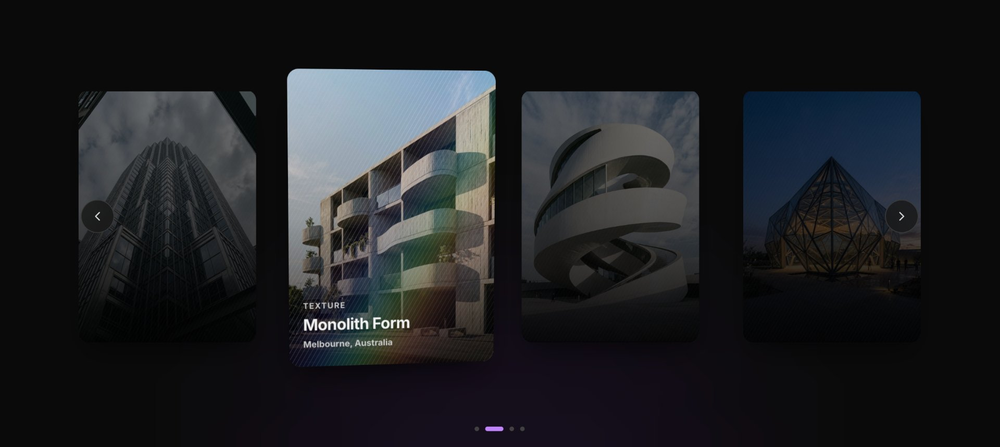

> 🌐 **Language / 语言：** [🇨🇳 中文](./README.md) · [🇺🇸 English](./README.en.md)

<div align="center">

# 🌈 Lenticular Carousel

### Zero-Dependency 3D Lenticular Interactive Effect

*Microlens refraction · Holographic rainbow foil · Pointer-driven 3D tilt · Layered text reveal*

<br>

[](#)
[](./LICENSE)
[](https://developer.mozilla.org/docs/Web/JavaScript)
[](https://developer.mozilla.org/docs/Web/API/CanvasRenderingContext2D)
[](https://smartaly.github.io/lenticular-carousel/)

**👉 [Live Demo](https://smartaly.github.io/lenticular-carousel/)** — GitHub Pages, open instantly, no install required.

<br>



</div>

---

A 3D lenticular interactive effect — microlens fluted-glass refraction + holographic rainbow foil + pointer-driven 3D tilt + layered text reveal.
**Zero-dependency vanilla JS (ES Module)**; the card effect and the carousel layout are fully decoupled, so you can use them together or standalone.

## 🔑 Keywords

> Helps code-search tools (GitHub Search, Sourcegraph, Cursor / Copilot and other AI coding assistants) locate this repo by topic.

**English：** lenticular card effect · holographic foil card · 3D tilt card · mouse-follow 3D card · pointer-driven interaction · Canvas 2D light effect · vanilla JS card component · zero-dependency UI effect · CSS preserve-3d z-depth · credit-card shine · rainbow gradient highlight · microlens fluted glass · interactive hover effect · standalone effect module · ES Module · no build · web animation
**中文：** 光栅画卡片效果 · 全息彩虹卡片 · 3D 倾斜卡片 · 鼠标跟随卡片 · 指针驱动交互 · Canvas 2D 高光 · 纯 JS 卡片组件 · 零依赖动效 · CSS 3D 透视 preserve-3d 纵深 · 银行卡反光 · 彩虹渐变高光 · 微透镜竖纹玻璃 · 悬停交互动效 · 独立效果模块 · ES Module · 无构建 · 网页动效

**More related terms：** hover effect · gradient animation · premium UI · beautify website · fancy card · glassmorphism · cursor-follow · mousemove effect · iridescent · glossy card · reflective card · parallax card · smooth animation · frontend micro-interaction · eye-catching UI · modern web effect · vanilla-tilt alternative · pure JS animation · web decoration ｜ 悬停效果 · 渐变动画 · 高级效果 · 高级感 · 美化网页 · 网页美化 · 炫酷卡片 · 玻璃拟态 · 流光 · 反光卡片 · 光泽卡片 · 视差卡片 · 流畅动画 · 前端微交互 · 吸睛 UI · 现代网页效果 · vanilla-tilt 替代 · 纯 JS 动画 · 网页装饰

## Contents

- [Features](#features)
- [Quick Start](#quick-start)
- [Architecture](#architecture)
- [Decoupling Contract](#decoupling-contract)
- [Performance](#performance)
- [3D Notes](#3d-notes-css-3d-flattening-pitfalls)
- [Using the Effect Module Standalone](#using-the-effect-module-standalone)
- [Parameters](#parameters)
- [How It Works](#how-it-works)
- [Tech Stack](#tech-stack)
- [License](#license)

## Features

- Moving the pointer left↔right compresses / expands the fluted slats as the viewing angle shifts, the rainbow beam travels with it, and the bottom text emerges as the transmission aperture opens.
- Local pointer highlight — the slat directly under the cursor brightens noticeably (glass body / prism spec / groove shadow respond together) and falls off smoothly with horizontal distance, so the hotspot tracks the pointer in real time.
- Three text lines each own independent Z-depth (tag / title / description), producing genuine perspective parallax layering when the card tilts.
- Moving to the card's left/right edges smoothly fades the rainbow highlight to fully hidden per diffraction physics, leaving only a neutral glass texture.
- On hover the card tilts in 3D and lifts along Z, with refractive parallax on the base photo.
- Supports a layer-exploded view (photo / foil Canvas / text separated along Z).
- Ships a live debug panel (9 sliders + 4 presets).

## Quick Start

ES Modules must be served over HTTP (`file://` is blocked by browser CORS):

```bash
npm start          # zero-dependency node static server, default http://localhost:5173
# or any static server you like: npx serve . / python3 -m http.server
```

## Architecture

```
index.html                 Demo shell (Tailwind CDN, no build step)
src/
├── lenticular-card.js     [Effect module] LenticularCard + LenticularRenderer
├── carousel.js            [Layout module] Carousel generic layout
├── presets.js             Parameter presets
├── data.js                Demo data
└── main.js                Assembly layer (the only place that knows all modules)
assets/cards/              Demo images (JPEG)
```


*Architecture source: [docs/architecture.svg](./docs/architecture.svg) (light / dark theme aware)*

### Decoupling Contract

The two modules **never import each other**; all communication goes through just three things:

| Direction | Channel | Content |
| --- | --- | --- |
| Effect → Layout | `onHover` / `onActivate` callbacks | "I was hovered / clicked" |
| Layout → Effect | `setActive(bool)` | "Are you the focused card?" (scale only) |
| Layout ← Effect | `element` (HTMLElement) | Card root element — the only thing the layout touches |

Swap either half without touching the other: replace `LenticularCard` with a plain image card and `Carousel` still works;
replace `Carousel` with a grid and `LenticularCard` remains a self-contained effect component.

### Performance

- All live cards **share one `requestAnimationFrame`** loop instead of spawning one per card.
- **Idle detection**: when the pointer and hover amount have settled and no param changed, drawing is skipped (Canvas keeps the last frame — zero visual difference).
- Canvas internal resolution is 2x (520×740) so slats stay crisp on retina.

### 3D Notes (CSS 3D flattening pitfalls)

All depth here relies on a complete `preserve-3d` chain. Below are pitfalls confirmed by testing (consistent on Chrome 131+ / Safari 17+):

- **Perspective must be the `perspective()` function** inside the rotated element's own `transform`. A `perspective` **property** on an ancestor does NOT reach grandchildren — their `translateZ` silently dies.
- **Ancestors on the 3D chain must not have `opacity < 1` / `filter` / `will-change: opacity`** — these are grouping properties that force `transform-style: flat`, killing every `translateZ` in the subtree. So text reveal opacity lives on **each line itself** (an element's own `opacity` does not affect its own `translateZ`).
- **Use `text-shadow`, not `drop-shadow`** for text — `filter` also triggers flattening.
- **Avoid `overflow: hidden`** on rotating containers (WebKit flattens); rounded-corner clipping is done by each layer's own `rounded-[14px]`, consistent across engines.

## Using the Effect Module Standalone

```js
import { LenticularCard } from './src/lenticular-card.js';

const card = new LenticularCard({
  image: 'your-image.jpg',
  tag: 'REPETITION',
  title: 'Concrete Chorus',
  description: 'Austin, Texas',
  params: { strips: 56, foil: 0.5, blur: 36, ridge: 0.5, refraction: 0.32, tilt: 14, lift: 40, warping: 0.45 },
  onHover: (hovered) => {},
  onMove: (mx, my) => {},
  onActivate: () => {},
});
document.body.append(card.element);

card.setParams({ foil: 0.9 });   // live tuning
card.setExploded(true);          // layer-exploded view
card.destroy();                  // destroy & leave ticker
```

## Parameters

| Param | Default | Range | Meaning |
| --- | --- | --- | --- |
| `strips` | 56 | 16–96 | Number of cylindrical microlens slats |
| `foil` | 0.50 | 0–1 | Thin-film interference rainbow foil brightness |
| `blur` | 36px | 10–64 | Rainbow Gaussian blur radius (spectral blend) |
| `ridge` | 0.50 | 0–1 | Slat edge micro-specular reflection |
| `refraction` | 0.32 | 0–1 | Refractive parallax of base photo through microlenses |
| `tilt` | 14° | 0–28 | Max 3D tilt following the pointer |
| `lift` | 40px | 0–80 | Z-lift of the active card toward viewer |
| `warping` | 0.45 | 0–1 | Slat width stretch on pointer pan |
| `inactiveDim` | 0.55 | 0.1–1 | Dim factor of inactive side cards (layout param) |

## How It Works

1. **The gray overlay slats are physically microlens fluted-glass.** At rest they are nearly invisible (only a faint glass glint); the text sits beneath the fluted glass and its visibility is governed by the grating's open/closed refraction.
2. **Natural edge hiding + Gaussian diffuse scattering.** As the pointer reaches the card edge, diffracted light leaves the Bragg window and the rainbow fades to invisible along a `sin^2.2` curve; a wide bloom / core spectral column / radial highlight — three passes with layered Gaussian blur — remove every hard edge.
3. **Pointer pan drives slat-width rhythm.** On the left, left-half slats compress hard (lens closed, text hidden); moving right widens the right slats (aperture opens, text fully clear).

## Tech Stack

- Vanilla JS ES Module (no framework, no build)
- Tailwind CSS via CDN (demo shell only; core modules depend on no CSS framework)
- Canvas 2D

## License

[MIT](./LICENSE)

---

<p align="center">
  <sub>🌈 Lenticular Carousel · Zero-Dependency 3D Lenticular Interactive Effect</sub>
</p>
