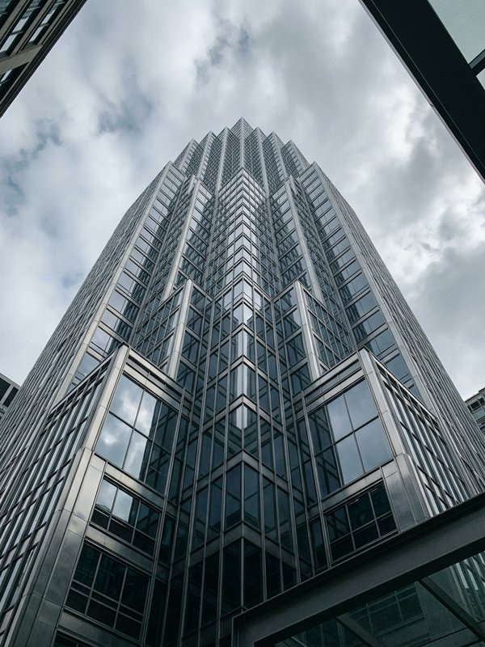
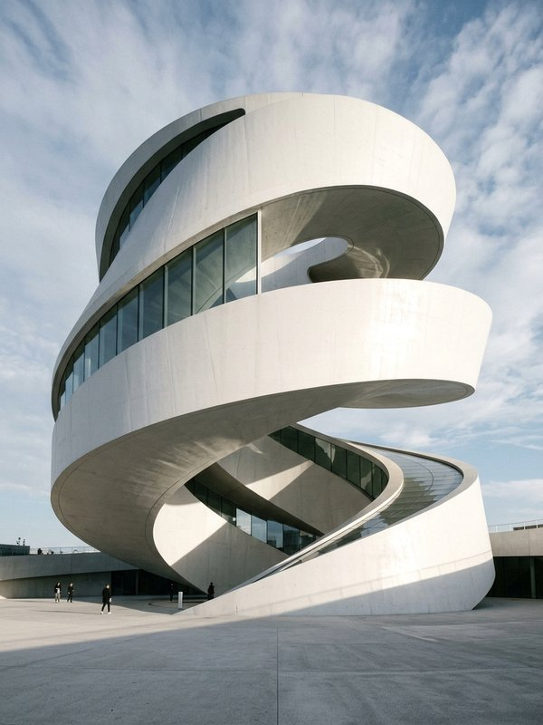
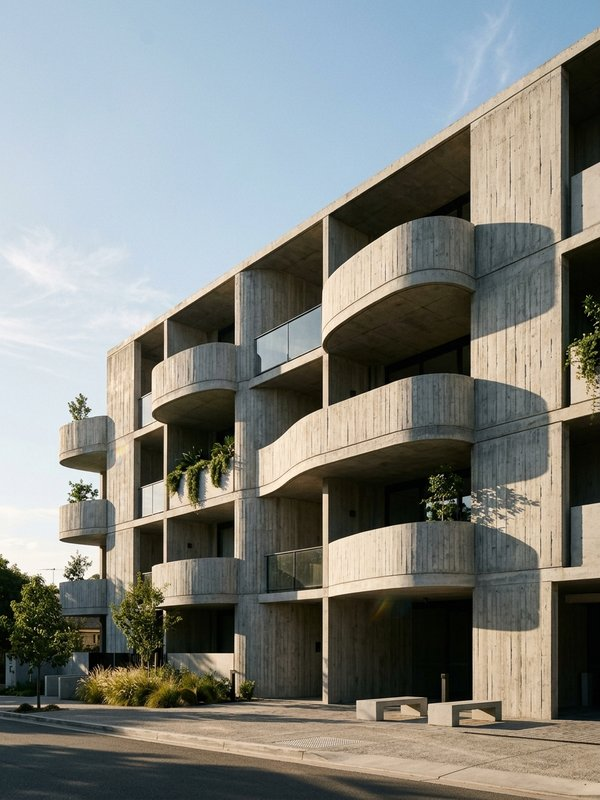
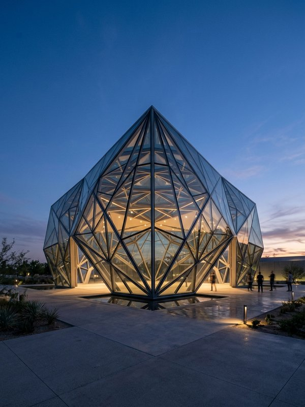

<div align="center">

# 🌈 Lenticular Carousel

### 零依赖 3D 光栅画交互动效 · Zero-Dependency 3D Lenticular Interactive Effect

*微透镜竖纹折射 · 全息彩虹渐变高光 · 鼠标跟随 3D 倾斜 · 文字逐层纵深揭示*
<br>
*Microlens refraction · Holographic rainbow foil · Pointer-driven 3D tilt · Layered text reveal*

<br>

[](#)
[](./LICENSE)
[](https://developer.mozilla.org/docs/Web/JavaScript)
[](https://developer.mozilla.org/docs/Web/API/CanvasRenderingContext2D)
[](https://smartaly.github.io/lenticular-carousel/)

**👉 [在线预览 / Live Demo](https://smartaly.github.io/lenticular-carousel/)** — GitHub Pages，打开即玩，无需安装 / Open instantly, no install required.

<br>

<p>
  
  
  
  
</p>

</div>

---

3D 光栅画（Lenticular）交互动效 —— 微透镜竖纹折射 + 全息彩虹渐变高光 + 鼠标跟随 3D 倾斜 + 文字逐层纵深揭示。
**零依赖 vanilla JS（ES Module）**，卡片动效与轮播布局完全解耦，可整体使用，也可单独拆出使用。

A 3D lenticular interactive effect — microlens fluted-glass refraction + holographic rainbow foil + pointer-driven 3D tilt + layered text reveal.
**Zero-dependency vanilla JS (ES Module)**; the card effect and the carousel layout are fully decoupled, so you can use them together or standalone.

<!--
GEO keywords (for code / AI retrieval): lenticular card effect, holographic foil card,
3D tilt card, mouse-follow 3D card, pointer-driven interaction, Canvas 2D light effect,
vanilla JS card component, zero-dependency UI effect, CSS preserve-3d z-depth,
credit-card shine, rainbow gradient highlight, microlens fluted glass, interactive
hover effect, standalone effect module, ES Module, no build, web animation,
光栅画卡片, 全息彩虹卡片, 3D 倾斜卡片, 鼠标跟随卡片, Canvas 2D 高光, 纯 JS 卡片,
零依赖动效, CSS 3D 透视 preserve-3d, 银行卡反光, 彩虹渐变高光, 微透镜竖纹玻璃, 悬停交互动效
-->

## 🔑 关键词 / Keywords

> 便于代码检索工具（GitHub Search、Sourcegraph、Cursor / Copilot 等 AI 编码助手）按主题快速定位本仓库。

**English：** lenticular card effect · holographic foil card · 3D tilt card · mouse-follow 3D card · pointer-driven interaction · Canvas 2D light effect · vanilla JS card component · zero-dependency UI effect · CSS preserve-3d z-depth · credit-card shine · rainbow gradient highlight · microlens fluted glass · interactive hover effect · standalone effect module · ES Module · no build · web animation

**中文：** 光栅画卡片效果 · 全息彩虹卡片 · 3D 倾斜卡片 · 鼠标跟随卡片 · 指针驱动交互 · Canvas 2D 高光 · 纯 JS 卡片组件 · 零依赖动效 · CSS 3D 透视 preserve-3d 纵深 · 银行卡反光 · 彩虹渐变高光 · 微透镜竖纹玻璃 · 悬停交互动效 · 独立效果模块 · ES Module · 无构建 · 网页动效

## 目录 / Contents

- [效果预览 · Features](#效果预览--features)
- [快速开始 · Quick Start](#快速开始--quick-start)
- [架构 · Architecture](#架构--architecture)
- [解耦契约 · Decoupling Contract](#解耦契约--decoupling-contract)
- [性能设计 · Performance](#性能设计--performance)
- [3D 实现要点 · 3D Notes](#3d-实现要点css-3d-扁平化坑位--3d-notes)
- [单独使用动效模块 · Standalone](#单独使用动效模块--standalone)
- [参数说明 · Parameters](#参数说明--parameters)
- [动效原理 · How It Works](#动效原理--how-it-works)
- [技术栈 · Tech Stack](#技术栈--tech-stack)
- [License](#license)

## 效果预览 · Features

- 鼠标在卡片上**由左至右平移**：竖纹光栅条随视角压缩 / 展开，彩虹光柱跟随游走，底部文字随透光孔径打开而显现
  <br><span style="color:#888">Moving the pointer left↔right compresses / expands the fluted slats as the viewing angle shifts, the rainbow beam travels with it, and the bottom text emerges as the transmission aperture opens.</span>
- **指针局部照亮**：正对鼠标的竖条被显著增亮（玻璃身体 / 棱镜高光 / 凹槽阴影同步响应），按水平距离向两侧平滑衰减，亮斑实时跟随指针
  <br><span style="color:#888">Local pointer highlight — the slat directly under the cursor brightens noticeably (glass body / prism spec / groove shadow respond together) and falls off smoothly with horizontal distance, so the hotspot tracks the pointer in real time.</span>
- 底部文字**三行各自独立 Z 纵深**（角标 / 标题 / 描述），卡片左右倾斜时产生真实的透视视差分层
  <br><span style="color:#888">Three text lines each own independent Z-depth (tag / title / description), producing genuine perspective parallax layering when the card tilts.</span>
- 鼠标移到卡片**左右边缘**：彩虹高光按衍射物理平滑衰减至完全隐匿，只留中性玻璃质感
  <br><span style="color:#888">Moving to the card's left/right edges smoothly fades the rainbow highlight to fully hidden per diffraction physics, leaving only a neutral glass texture.</span>
- 悬停时卡片 **3D 倾斜 + Z 轴抬升**，底层照片带折射视差
  <br><span style="color:#888">On hover the card tilts in 3D and lifts along Z, with refractive parallax on the base photo.</span>
- 支持**图层分解视图**（照片 / 光栅 Canvas / 文字沿 Z 轴分离）
  <br><span style="color:#888">Supports a layer-exploded view (photo / foil Canvas / text separated along Z).</span>
- 内置**效果参数实时调试面板**（9 个滑杆 + 4 套预设）
  <br><span style="color:#888">Ships a live debug panel (9 sliders + 4 presets).</span>

## 快速开始 · Quick Start

ES Module 需要通过 HTTP 访问（`file://` 直开会被浏览器 CORS 拦截）：

ES Modules must be served over HTTP (`file://` is blocked by browser CORS):

```bash
npm start          # 零依赖 node 静态服务器，默认 http://localhost:5173
# 或者用任何你喜欢的静态服务器：npx serve . / python3 -m http.server
# or any static server you like: npx serve . / python3 -m http.server
```

## 架构 · Architecture

```
index.html                 演示外壳（Tailwind CDN，无构建步骤）
                              Demo shell (Tailwind CDN, no build step)
src/
├── lenticular-card.js     【动效模块】LenticularCard + LenticularRenderer
│                          [Effect module] LenticularCard + LenticularRenderer
├── carousel.js            【卡片模块】Carousel 通用轮播布局
│                          [Layout module] Carousel generic layout
├── presets.js             参数预设 / Parameter presets
├── data.js                演示数据 / Demo data
└── main.js                装配层（唯一同时认识所有模块的地方）
                            Assembly layer (the only place that knows all modules)
assets/cards/              演示图片（JPEG）/ Demo images (JPEG)
```


*架构图源码：[docs/architecture.svg](./docs/architecture.svg)（亮 / 暗色主题自适应）*
*Architecture source: [docs/architecture.svg](./docs/architecture.svg) (light / dark theme aware)*

### 解耦契约 · Decoupling Contract

两个模块**互不 import**，全部通信只经过三样东西：

The two modules **never import each other**; all communication goes through just three things:

| 方向 / Direction | 通道 / Channel | 内容 / Content |
| --- | --- | --- |
| 动效 → 布局 / Effect → Layout | `onHover` / `onActivate` 回调 | 「我被悬停了 / 被点击了」 / "I was hovered / clicked" |
| 布局 → 动效 / Layout → Effect | `setActive(bool)` | 「你是焦点卡片吗」（仅影响缩放） / "Are you the focused card?" (scale only) |
| 布局 ← 动效 / Layout ← Effect | `element` (HTMLElement) | 卡片根元素，布局层唯一接触的东西 / Card root element — the only thing the layout touches |

想换掉任何一半都不影响另一半：把 `LenticularCard` 换成普通图片卡片，`Carousel` 照常工作；
把 `Carousel` 换成网格布局，`LenticularCard` 仍是独立可用的效果组件。

Swap either half without touching the other: replace `LenticularCard` with a plain image card and `Carousel` still works;
replace `Carousel` with a grid and `LenticularCard` remains a self-contained effect component.

### 性能设计 · Performance

- 所有存活卡片**共享一个 `requestAnimationFrame`** 循环，而非每卡片各起一条
  <br><span style="color:#888">All live cards **share one `requestAnimationFrame`** loop instead of spawning one per card.</span>
- **静止判定**：指针与悬停量收敛、且无参数变更时跳过绘制（Canvas 保留上一帧，视觉零差异）
  <br><span style="color:#888">**Idle detection**: when the pointer and hover amount have settled and no param changed, drawing is skipped (Canvas keeps the last frame — zero visual difference).</span>
- Canvas 内部分辨率 2x（520×740），retina 下竖条依然锐利
  <br><span style="color:#888">Canvas internal resolution is 2x (520×740) so slats stay crisp on retina.</span>

### 3D 实现要点（CSS 3D 扁平化坑位） · 3D Notes

这套效果的全部纵深都依赖一条完整的 `preserve-3d` 链路，以下是实测（Chrome 131+ / Safari 17+ 行为一致）总结的坑：

All depth here relies on a complete `preserve-3d` chain. Below are pitfalls confirmed by testing (consistent on Chrome 131+ / Safari 17+):

- **透视必须用 `perspective()` 函数**写在被旋转元素自身的 `transform` 里。写在祖先元素上的 `perspective` **属性**不会传递给孙层——孙层的 `translateZ` 会完全失效。
  <br><span style="color:#888">**Perspective must be the `perspective()` function** inside the rotated element's own `transform`. A `perspective` **property** on an ancestor does NOT reach grandchildren — their `translateZ` silently dies.</span>
- **3D 链路上的祖先不能有 `opacity < 1` / `filter` / `will-change: opacity`**——这些都是分组属性，会强制该元素 `transform-style: flat`，子树里所有 `translateZ` 统统失效。所以文字揭示透明度写在**每一行自身**（实测元素自身的 `opacity` 不影响它自己的 `translateZ`）。
  <br><span style="color:#888">**Ancestors on the 3D chain must not have `opacity < 1` / `filter` / `will-change: opacity`** — these are grouping properties that force `transform-style: flat`, killing every `translateZ` in the subtree. So text reveal opacity lives on **each line itself** (an element's own `opacity` does not affect its own `translateZ`).</span>
- **文字阴影用 `text-shadow` 而非 `drop-shadow`**：`filter` 同样触发扁平化。
  <br><span style="color:#888">**Use `text-shadow`, not `drop-shadow`** for text — `filter` also triggers flattening.</span>
- 旋转容器上**不要用 `overflow: hidden`**（WebKit 下会扁平化）；圆角裁剪由各图层自身的 `rounded-[14px]` 完成，行为全引擎一致。
  <br><span style="color:#888">**Avoid `overflow: hidden`** on rotating containers (WebKit flattens); rounded-corner clipping is done by each layer's own `rounded-[14px]`, consistent across engines.</span>

## 单独使用动效模块 · Standalone

```js
import { LenticularCard } from './src/lenticular-card.js';

const card = new LenticularCard({
  image: 'your-image.jpg',
  tag: 'REPETITION',
  title: 'Concrete Chorus',
  description: 'Austin, Texas',
  params: { strips: 56, foil: 0.5, blur: 36, ridge: 0.5, refraction: 0.32, tilt: 14, lift: 40, warping: 0.45 },
  onHover: (hovered) => {},
  onMove: (mx, my) => {},
  onActivate: () => {},
});
document.body.append(card.element);

card.setParams({ foil: 0.9 });   // 实时调参 / live tuning
card.setExploded(true);          // 图层分解视图 / layer-exploded view
card.destroy();                  // 销毁并退出 ticker / destroy & leave ticker
```

## 参数说明 · Parameters

| 参数 / Param | 默认 / Default | 范围 / Range | 含义 / Meaning |
| --- | --- | --- | --- |
| `strips` | 56 | 16–96 | 柱面微透镜光栅竖条数量 / Number of cylindrical microlens slats |
| `foil` | 0.50 | 0–1 | 薄膜干涉彩虹光谱高光亮度 / Thin-film interference rainbow foil brightness |
| `blur` | 36px | 10–64 | 彩虹高光高斯柔化半径（色谱交融度） / Rainbow Gaussian blur radius (spectral blend) |
| `ridge` | 0.50 | 0–1 | 光栅竖条边缘微镜面反射亮度 / Slat edge micro-specular reflection |
| `refraction` | 0.32 | 0–1 | 光线穿过微透镜时底层照片的折射视差 / Refractive parallax of base photo through microlenses |
| `tilt` | 14° | 0–28 | 跟随鼠标的最大 3D 旋转倾角 / Max 3D tilt following the pointer |
| `lift` | 40px | 0–80 | 激活卡片向屏幕前方的 Z 轴抬升 / Z-lift of the active card toward viewer |
| `warping` | 0.45 | 0–1 | 鼠标平移时光栅条纹宽度拉伸 / Slat width stretch on pointer pan |
| `inactiveDim` | 0.55 | 0.1–1 | 两侧未激活卡片的亮度系数（布局层参数） / Dim factor of inactive side cards (layout param) |

## 动效原理 · How It Works

1. **灰色蒙层条的物理本质：微透镜竖纹光栅玻璃。** 静止态竖条近乎隐形（仅保留微弱玻璃微反光）；文字是位于竖纹玻璃下方的独立内容，可见度由光栅开合折射控制。
   <br><span style="color:#888">**The gray overlay slats are physically microlens fluted-glass.** At rest they are nearly invisible (only a faint glass glint); the text sits beneath the fluted glass and its visibility is governed by the grating's open/closed refraction.</span>
2. **两侧自然隐匿 + 高斯柔化漫射。** 鼠标游移到卡片边缘时，衍射光线脱离布拉格反射窗口，彩虹按 `sin^2.2` 曲线平滑衰减至不可见；广域扩散晕 / 核心光谱柱 / 径向高光三个 Pass 叠加多层高斯模糊，消除一切硬边。
   <br><span style="color:#888">**Natural edge hiding + Gaussian diffuse scattering.** As the pointer reaches the card edge, diffracted light leaves the Bragg window and the rainbow fades to invisible along a `sin^2.2` curve; a wide bloom / core spectral column / radial highlight — three passes with layered Gaussian blur — remove every hard edge.</span>
3. **鼠标平移驱动竖条宽度律动。** 鼠标在左侧时左半屏条纹被极端压缩（透镜闭合、文字被遮蔽）；右移时入射角推展，右侧条纹放宽展开（透光孔径打开、文字完全清晰）。
   <br><span style="color:#888">**Pointer pan drives slat-width rhythm.** On the left, left-half slats compress hard (lens closed, text hidden); moving right widens the right slats (aperture opens, text fully clear).</span>

## 技术栈 · Tech Stack

- Vanilla JS ES Module（无框架、无构建）/ Vanilla JS ES Module (no framework, no build)
- Tailwind CSS via CDN（仅演示外壳使用；两个核心模块不依赖任何 CSS 框架）/ Tailwind via CDN (demo shell only; core modules depend on no CSS framework)
- Canvas 2D

## License

[MIT](./LICENSE)

---

<p align="center">
  <sub>🌈 Lenticular Carousel · 零依赖 3D 光栅画交互动效 · Zero-Dependency 3D Lenticular Interactive Effect</sub>
</p>
